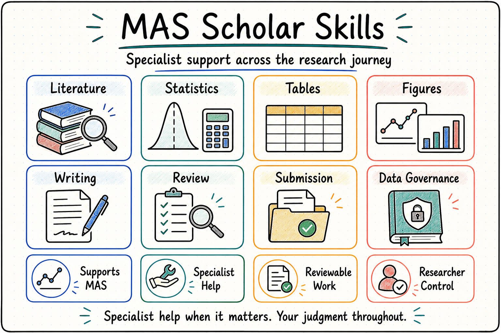

<p align="center">
  
</p>

<p align="center">
  <a href="./README.md"><strong>English</strong></a> | <a href="./README.zh-CN.md">中文</a>
</p>

<h1 align="center">MAS Scholar Skills</h1>

<p align="center"><strong>Professional medical-research skills for MAS</strong></p>
<p align="center">Figures · Tables · Statistics · Literature · Writing · Review · Submission · Data Governance</p>

<!--
Owner: `mas-scholar-skills`
Purpose: `public_repository_entry`
State: `public_entry`
Machine boundary: Human-readable public entry. Package identity, exports, module ids, skill bodies, authority flags, gallery bytes, installed-package currentness, and consuming-domain decisions remain in contracts, source, manifests, OPL package readback, repo-native verification, and MAS/domain owner surfaces.
-->

<p align="center">
  
</p>

MAS Scholar Skills gives MAS reusable, task-focused expertise for producing and
reviewing medical-paper work. MAG consumes a narrower required capability set
for grant work. In both cases, the package helps
Codex choose an appropriate specialist, work from explicit evidence, prepare
inspectable candidate material, and route the result back to the consuming
domain owner.

The package is a consumer-neutral framework capability provider designed for
independent release so its skills, quality references, display pack, and
specialist catalog can evolve independently. The target publication route is
complete Package bytes in the owner's GHCR `latest-stable`; Codex Plugin/Skill
materialization is only a carrier projection. Fresh owner publication and
complete actual-carrier readback remain unproven. The target MAS and MAG
dependency edge requires Package identity presence and required capability
callability, not cross-Package version/ABI solving, lock, payload, digest,
Release Set, or atomic closure. The current manifest models both profiles as
required runtime dependencies with fail-closed identity/callability gates; the
domain agents retain all stage, quality, artifact, and readiness authority.
The historical `opl-scholarskills` name is provenance only and is not an active
skill.
The cross-repository migration SSOT is the App
[`opl-package-platform-composition-migration.md`](https://github.com/gaofeng21cn/one-person-lab-app/blob/main/docs/active/opl-package-platform-composition-migration.md).

## What It Covers

| Module | Typical work |
| --- | --- |
| Display | Figure design, style, composition, export checks, and visual-review candidates |
| Tables | Table shells, denominator and metric traceability, and consistency checks |
| Statistics | Analysis-plan and result review, assumptions, uncertainty, and reproducibility |
| Literature | Search strategy, source screening, citation verification, and claim-support mapping |
| Writing | Evidence-traced manuscript sections and revision candidates |
| Review | Independent review packets, defect routing, and revision priorities |
| Submission | Offline journal-layout profiles, default reader layout, file inventory, declarations, and response preparation |
| Data Governance | Data manifests, dictionaries, lineage, lifecycle, access, and reproducibility candidates |

The current source exports aggregate/core Codex skills alongside task-selected
routers and named-specialty skills (cataloged in
`contracts/scholar-skills-capability-modules.json`). Specialty skills are present
for discovery but selected only when a task actually needs that specialty.
The machine catalog also includes two pure adapter modules for scientific search
and reference verification; OPL Connect performs their network I/O and records
receipts. The Package-owned scientific-search adapter covers primary PubMed/PMC
discovery plus Crossref/OpenAlex metadata, coverage, and citation-graph fallback;
Framework supplies transport and receipt execution without embedding provider
search logic.

See [Capability Modules](./docs/capability-modules.md) for the current mapping.

For EHR or registry evidence, `registry_signal_validity_pack` folds into one
`ehr_registry_signal_validity_ref`; `medical-statistical-review` is its sole
professional producer and owner route. Other specialists may consume that ref
without creating a parallel validity judgment.

## For Codex & Host Projection

`opl-package.json` (`schema_version: "opl.package.v2"`, `identity.id: "mas-scholar-skills"`) is the single canonical Package manifest at the repository root, and `skills/` is the single source of truth for all exported Skills (no duplicate copied tree under `plugins/`, and no retired `.codex-plugin/plugin.json` or `.agents/plugins/marketplace.json`). When a host (such as OPL Studio / Codex) projects this Package into a target home or workspace, the active Package lifecycle (`opl pack`) owns installation and synchronization; host projection is derived from `opl-package.json` (`provides.skills` and `host_hints.codex`), not a separate identity source.

Use an isolated state/home directory for host-projection installation checks instead of mutating live user configuration.

## For Agents

Agents that consume repository sources directly should start from
`skills/mas-scholar-skills/SKILL.md`, then route to the selected
`skills/<skill-id>/SKILL.md`. Read canonical Package identity and exported
Skill declarations (`provides.skills`, `provides.module_ids`) from
`opl-package.json` (`opl.package.v2`), read consumer dependency profiles and
runtime bindings from `contracts/opl_capability_package_manifest.json`, and read
exposure, routing, and no-authority policy from
`contracts/scholar-skills-capability-modules.json`.

The Codex Skill projection is a host carrier projection only. Materializing or
enabling it establishes Codex discovery of the packaged Skills; it does not
install MAS or MAG, satisfy a consumer dependency by itself, write study or
grant truth, or issue an owner receipt.

## Use With MAS

MAS requires this Package (`mas-scholar-skills`), while individual named
specialty Skills remain task-selected (`opt_in`, with `mas-scholar-skills` as the
`default` aggregate entry). Installing MAS must therefore ensure the
ScholarSkills Package identity and the required MAS capability set are present
and callable; missing capability blocks MAS only and routes to managed
install/repair. It does not block unrelated Packages or introduce a
version/ABI/lock/payload gate:

```bash
opl pack install <mas-source> --json
opl pack sync --json
```

Inspect the installed Package state and manifest readback directly through OPL
Framework v2 rather than inferring it from this checkout:

```bash
opl pack inspect mas --json
opl pack inspect mas-scholar-skills --json
opl pack ensure mas --json
```

Cloning this repository alone does not install MAS or prove that complete
ScholarSkills bytes are installed. A Codex Skill projection alone is also
insufficient. Missing required Package identity or capability callability
blocks MAS, while unrelated Packages remain available.

Use each surface only for the state it owns:

| Surface | What a positive readback proves | What it does not prove |
| --- | --- | --- |
| Host Codex Skill projection | Selected Skills are materialized/discoverable in that Codex host projection. | OPL Package identity/currentness, MAS/MAG dependency closure, or domain readiness. |
| `opl pack inspect ... --json` / OPL Package maintenance receipt | Installed Package identity (`opl.package.v2`), selected source/version/digest, and payload verification recorded by that runtime. | Consumer capability callability or a study/grant verdict. |
| MAS or MAG dependency/capability readback | The consumer's required edge and selected capability set are callable for that consumer. | Publication, submission, fundability, or owner acceptance. |
| MAS, MAG, or study/grant owner receipts | Only the exact domain state and artifact bytes bound by that receipt. | Broader Package, carrier, or production state not named by the receipt. |

Inside a MAS task, the normal path is:

```text
MAS stage goal and evidence
  -> matching medical-* specialist skill
  -> candidate refs, review findings, or route-back recommendation
  -> MAS/domain owner accepts, rejects, or routes the work
```

The aggregate `mas-scholar-skills` skill is a discovery and routing entry. The
selected `medical-*` skill carries the detailed professional workflow; MAS stage
prompts remain the owner of stage validity, evidence thresholds, and acceptance.

## Use With MAG

MAG keeps its native grant workflow as the only stage and authority owner. Its
required ScholarSkills capability set includes
`medical-research-lit`, `medical-statistical-review`,
`medical-methodology-planner`, `medical-evidence-integrity-reviewer`,
`medical-evidence-synthesis-and-claim-map`, or
`medical-reference-integrity-auditor`.

```text
MAG grant prompt
  -> required ScholarSkills Package and callable grant capability set
  -> matching medical-* Skill selected for the task
  -> refs-only candidate handoff
  -> MAG accepts, rejects, or routes back through its own authority surface
```

Missing Package identity or required capability callability blocks MAG only and
routes to managed install/repair; it does not block unrelated Packages or grant
ScholarSkills any domain authority. Named specialty exposure remains
task-selected. The required machine profile is now the current owner contract.
It does not transfer domain truth, quality verdict, artifact authority, or
readiness to this capability provider.

`medical-submission-prep` includes an offline-first publication-layout catalog.
Named journals use a matching local adaptation profile; an unspecified journal
uses the publication-grade `general-medical-reader.v1` template. The core reader
outputs are always `paper.pdf` and `paper_with_supplementary.pdf`. Formal
submission refreshes the linked official instructions before any compliance
claim. Frontiers is represented once as a publisher-family profile, so any
`Frontiers in ...` journal can use the same maintained baseline without a
network lookup during ordinary authoring.

## Authority Boundary

This package prepares candidate material. It does not write study or grant
truth or artifact bodies, sign owner or reviewer receipts, create typed
blockers, mutate runtime state or strategy memory, choose the current package,
or claim fundability, quality/export, or publication readiness. Those decisions
remain with MAS, MAG, or the consuming domain owner.

Use [No-Authority Boundary](./docs/no-authority-boundary.md) for the durable rule
and machine references.

## Medical Display Gallery

[`gallery/medical-display/`](./gallery/medical-display/) is a compact human-review
package for template and visual-audit references. Its manifest and snapshot own
the exact current members and fingerprints. A gallery item is a design reference,
not proof of a live renderer, paper quality, owner acceptance, or publication
readiness.

See [Display Gallery](./docs/gallery/display-gallery.md) for maintenance and
consumption boundaries.

## Repository Map

```text
skills/                         aggregate, core, router, and specialty skills
contracts/                      package identity, module catalog, and boundaries
references/                     shared quality and handoff references
packs/medical-display-core/     Display source pack and renderer verification
packs/medical-publication-layouts/  reader template, journal profiles, and citation assets
gallery/medical-display/        compact human-review package
docs/                           operating, catalog, boundary, and active-truth docs
scripts/verify.sh               repository verification entry
```

## Verify

```bash
scripts/verify.sh fast
scripts/verify.sh render
scripts/verify.sh full
```

`fast` checks contracts, adapters, repository consistency (`tests/consistency/`),
and skill kernels (`tests/kernels/`) via `uv run --frozen pytest` (locked in
`pyproject.toml` / `uv.lock`). `render` checks gallery and renderer regressions.
`full` runs both. Passing any lane is repository evidence only; it is not
runtime, domain, artifact, publication, or production readiness.

## Documentation

- [Docs Index](./docs/README.md)
- [Active Truth](./docs/active/mas-scholar-skills-ideal-state-gap-plan.md)
- [Operating Model](./docs/mas-scholar-skills-operating-model.md)
- [Capability Modules](./docs/capability-modules.md)
- [No-Authority Boundary](./docs/no-authority-boundary.md)
- [Display Gallery](./docs/gallery/display-gallery.md)
